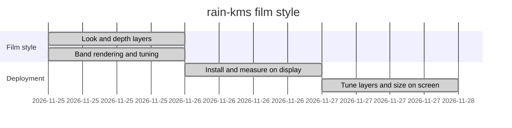

# rain-kms — film style (2026-11-25)

## Goal

A second rendering style, `film`, that looks like the monitors in *The Matrix*
(1999) and adds depth, while keeping the kiosk light (target: under ~5 ms per
frame at 1920×1080 on the Alder Lake-N machine, a few MB of RSS).

## Scope

- `--style film|rainbow`; `film` becomes the default, `rainbow` keeps v1.
- Depth layers (`--layers`), glow, white-burning heads, mirrored half-width kana.
- Band-based rendering so the full-frame rebuild stays in cache.
- Measure on the display as the kiosk service, then tune `--layers`/`--size` for
  the target screen.

## Risks

- CPU: the film style costs ~4× the rainbow style per frame. If it competes with
  other services, use `--layers 2` or `--layers 3`, or go back to `--style rainbow`.

