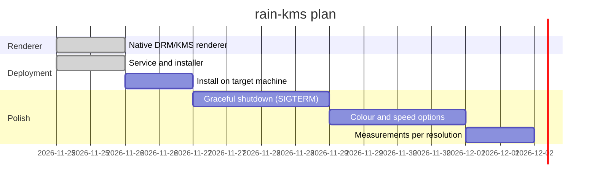

# rain-kms — plan (2026-11-25)

## Goal

A kiosk display that shows a katakana rain animation with the smallest possible
memory footprint, starting automatically at boot.

## Scope

- Native renderer drawing directly to DRM/KMS (done).
- systemd service and installer for a dedicated `kiosk` user (done, pending
  installation on the target machine).
- Hardening and polish: clean shutdown on SIGTERM, configurable colours.
- Optional: 4K output if CPU allows, or GPU-assisted rendering.

## Milestones

1. **M1 — Working renderer**: katakana rain on the real display, measured RAM
   and CPU. *Done.*
2. **M2 — Kiosk deployment**: service installed and running at boot on the
   target machine.
3. **M3 — Polish**: graceful shutdown, colour/speed options, documentation of
   measurements across resolutions.

## Risks

- Another program holding DRM master on the same output (e.g. a desktop session)
  prevents the kiosk from taking the display.
- Display mode support varies; the program falls back to the native mode when
  the requested resolution is not available.

